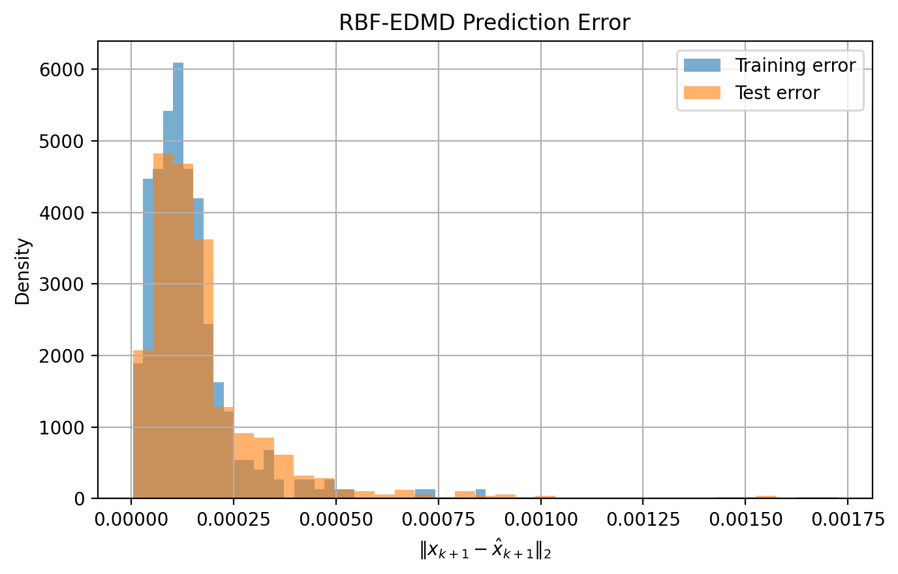
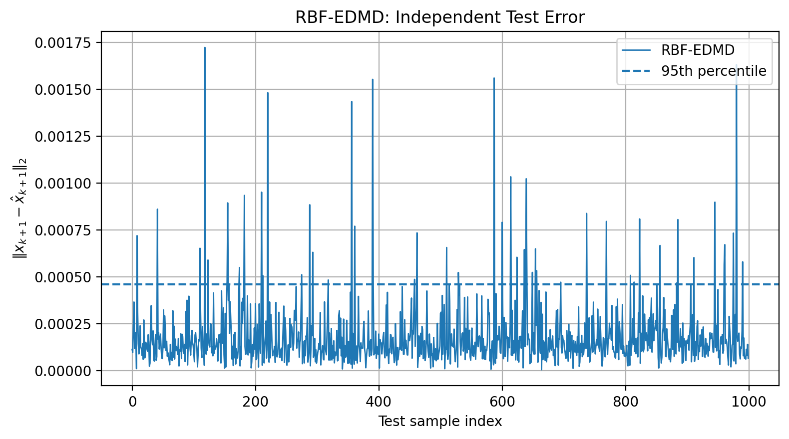
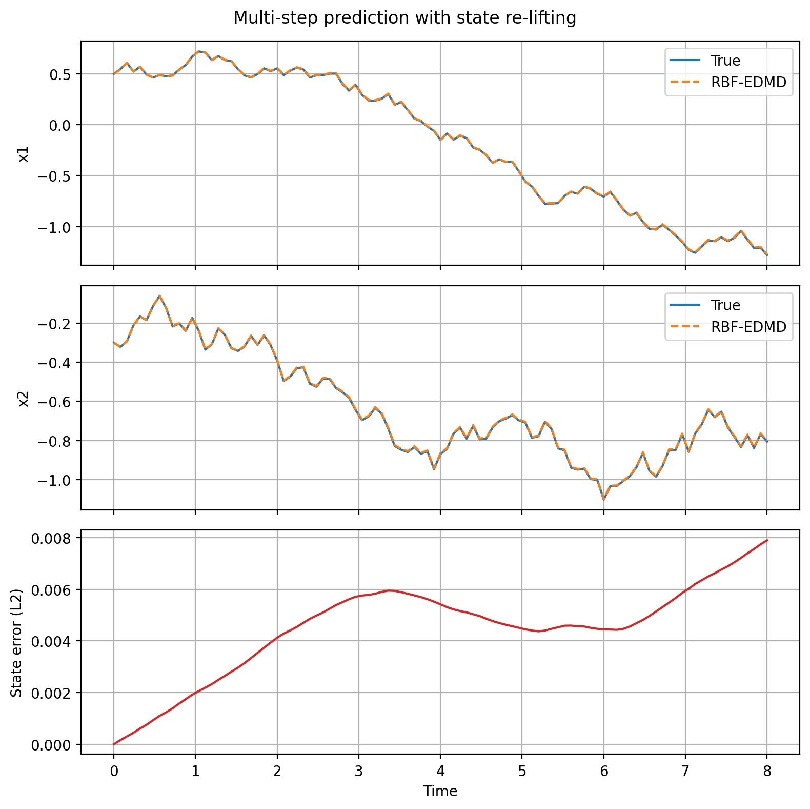

# RBF-EDMD Control Demo

A reproducible Python experiment for learning a controlled nonlinear
system using radial basis function (RBF) features and regularized
least-squares regression.

The experiment evaluates one-step prediction, compares two simple
baselines, and demonstrates multi-step prediction with state re-lifting.

## Model

The simulated system is:

```text
x_next = x + Ts * (u + d(x))

d(x) = [
    0.20 * sin(1.5 * x2),
   -0.15 * cos(1.2 * x1)
]
```

Both the state and control input have two components.

The learned model uses:

```text
z = [x; RBF(x)]
z_next = A @ z + B @ u
```

The first two coordinates of `z_next` give the predicted state.

This is an explicit RBF-feature EDMD model with additive control input.
It is not a bilinear model or a dual kernel-matrix implementation.

## Setup

Python 3.12 was used for the recorded experiment.

From the project directory, create and activate a virtual environment:

```bash
python3 -m venv .venv
source .venv/bin/activate
```

Install dependencies:

```bash
python -m pip install -r requirements.txt
```

## Run

```bash
python experiment.py
```

The script prints evaluation metrics and displays three figures.
Depending on the plotting backend, close each figure to continue.

Results are also saved to `results/`.
Running the experiment again overwrites those output files.

For a non-interactive run on macOS or Linux:

```bash
MPLBACKEND=Agg python experiment.py
```

## Experiment Configuration

| Parameter | Value |
|-----------|------:|
| Training seed | 3 |
| Sampling time | 0.08 |
| Training samples | 300 |
| Test samples | 1000 |
| RBF centers | 40 |
| Lifted dimension | 42 |
| RBF width | 0.8 |
| Ridge regularization | 0.00001 |
| Input range, per component | [-1.2, 1.2] |

Training and test states are sampled independently from:

```text
x1 in [-2.5, 2.5]
x2 in [-1.5, 1.5]
```

RBF centers are selected from the training data only.
The nonlinear drift function is used by the simulator, not by
the learned predictor.

## One-Step Prediction

The error for each sample is the Euclidean distance between the
true and predicted next states.

RMSE is defined as:

```text
sqrt(mean(sum((x_next - x_pred)**2, axis=1)))
```

It is not averaged separately over the two state components.

Recorded test results:

| Predictor | Test RMSE |
|-----------|----------:|
| Persistence: x_next = x | 0.07940061 |
| Input-only: x_next = x + Ts * u | 0.01501498 |
| RBF-EDMD | 0.0002564076 |

The input-only baseline assumes knowledge of the sampling time
and the additive input effect, while ignoring nonlinear drift.

RBF-EDMD training RMSE was approximately 0.0001803390.





The dashed line in the test-error plot is the empirical 95th
percentile, not a guaranteed error bound.

## Multi-Step Prediction

The rollout uses:

- Initial state: [0.5, -0.3]
- Steps: 100
- Input seed: 42
- Total simulated time: 8 time units

The simulator and predictor receive the same input sequence.
After initialization, the predictor uses its own predicted state,
without corrections from the true trajectory.

RBF features are recomputed from the predicted state at every step.
This differs from propagating the lifted state continuously.

| Metric | Recorded value |
|--------|---------------:|
| Trajectory RMSE, excluding initial state | 0.004855465 |
| Final-step error | 0.007891762 |
| Maximum error | 0.007891762 |



## Project Structure

```text
edmd-control-demo/
├── experiment.py
├── requirements.txt
├── .gitignore
├── README.md
└── results/
    ├── metrics.json
    ├── rollout_metrics.json
    ├── error_distribution.png
    ├── test_errors.png
    └── rollout.png
```

## Limitations

- One-step results use one training seed and one independent test set.
- Training and test samples come from the same sampling domain.
- The simulator has no added measurement or process noise.
- Multi-step results cover one initial state and one input sequence.
- These experiments do not establish general stability, safety,
  or out-of-domain prediction guarantees.
- Dependency versions are not yet pinned; numerical results may
  vary slightly across environments.

## Automated Tests

Install development dependencies and run the tests:

```bash
python -m pip install -r requirements-dev.txt
python -m pytest -q
```

Four tests cover metric calculations, simulated data generation,
evaluation with an exact predictor, and learned-model performance
against the baselines on a fixed dataset.

Tests do not validate the saved figures or establish performance
guarantees for other datasets.